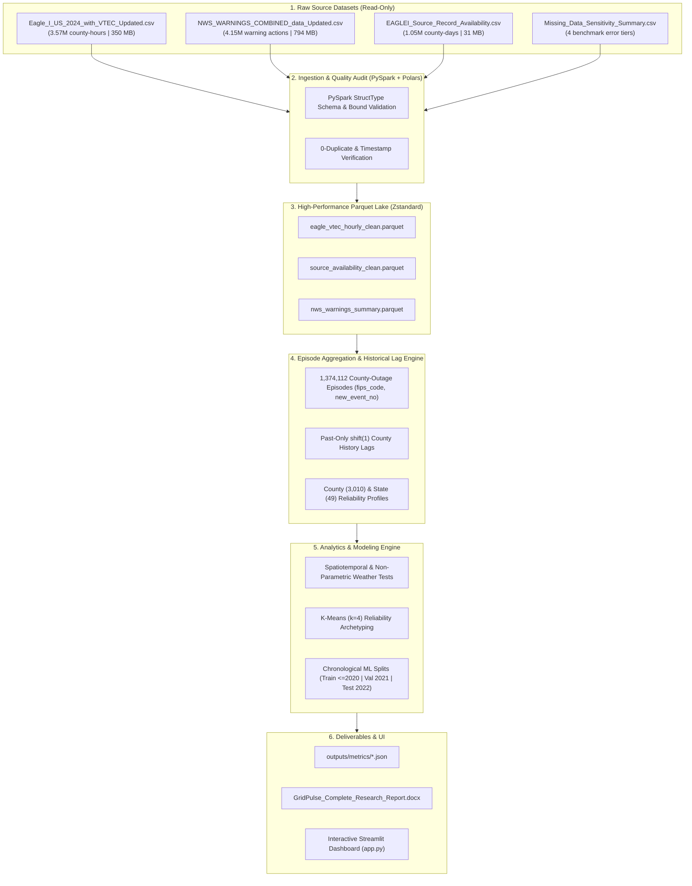

<div align="center">

# ⚡ GridPulse
### Research-Grade Power Outage Analytics, Weather-Warning Associations, and Regional Reliability Assessment

[](https://www.python.org/)
[](https://spark.apache.org/)
[](https://streamlit.io/)
[](https://scikit-learn.org/)
[](https://docs.pytest.org/)
[](https://opensource.org/licenses/MIT)
[](https://github.com/psf/black)

**A reproducible Big Data Analytics research pipeline and interactive application investigating power outage severity, severe weather hazard regimes, and regional electric grid vulnerability across 3.57M+ observations (2015–2023).**

[Research Objective](#-research-objective) • [Key Findings](#-key-empirical-findings) • [Architecture](#-system-architecture) • [Dashboard](#-interactive-dashboard) • [Quickstart](#-quickstart-guide) • [Tests](#-testing--quality-assurance) • [Docs](#-documentation-index)

</div>

---

## 🔬 Research Objective

**Core Research Question:**
> *Can historical outage behaviour, weather-warning characteristics, temporal patterns, and geographic context help explain outage severity and identify regions with recurring power-reliability problems?*

GridPulse investigates this question by harmonizing data from two major U.S. federal observation programs:
1. **DOE EAGLE-I (Environment for Analysis of Geo-Located Energy Information):** Electric grid customer outage monitoring across U.S. counties.
2. **NOAA NWS VTEC (Valid Time Event Code):** Operational meteorological bulletins covering 59 severe hazard phenomena.

### Key Analytical Guardrails
* **Absence $\neq$ Zero Outages:** In source availability audits, **38.91% of county-days exhibit a 100% reporting gap** (zero 15-minute telemetry polls). Unreported intervals are explicitly distinguished from confirmed zero outages.
* **Pseudoreplication Prevention:** Contiguous outages share identical duration (`evDur_Hr`) and peak severity (`Max_outage`) metrics across hours. GridPulse aggregates the **3,572,394 county-hour rows** into **1,374,112 distinct contiguous episodes `(fips_code, new_event_no)`**.
* **Denominator Discipline:** Regional profiles avoid raw-count ranking bias by normalizing peak outages against county-specific static baselines (`Max_outage / median_sum`) alongside explicit telemetry completeness tiers.
* **Zero-Leakage Temporal Evaluation:** Predictive modeling evaluates onset-time escalation strictly at **Hour 1** using past-only `shift(1)` historical features, trained on **2015–2020**, tuned on **2021**, and evaluated once on an **untouched 2022 test set (214,185 episodes)**.

---

## 📊 Key Empirical Findings

### 1. Telemetry Missingness Sensitivity (RQ1)
* **Benchmark Error Quantified:** From `Missing_Data_Sensitivity_Summary.csv` (91.52M benchmark observations), telemetry completeness `< 50%` introduces a **75.0% median relative error** (`2.25` customers median absolute difference) in outage magnitude, compared to `18.75%` at `75%–99%` completeness.
* **In-Sample Distribution:** Across 3.57M harmonized hours, mean completeness is **62.01%** (median `62.5%`), with **30.52%** achieving complete 4/4 15-minute polling.

### 2. Weather-Warning Associations (RQ2)
* **Hazard Heterogeneity ($H = 28,328.59, p < 0.0001$):** Non-parametric Kruskal-Wallis testing confirms stark severity stratification across weather regimes.
* **Severe Convective Dominance:** **Severe Thunderstorm (`SV`)** co-occurs with **53.5%** (`735,490`) of all warning-matched outage episodes (`16.27%` reach $\ge 100$ customers out).
* **Extreme Tail Risk:** **Extreme Wind (`EW`)** (`74.03%` $\ge 100$ customers) and **Tornado (`TO`)** (`19.35%` $\ge 100$ customers; mean peak `559.1` customers) carry the highest escalation probabilities.
* **Completeness Robustness:** Restricting to high-completeness episodes ($\ge 75\%$) confirms ranking consistency with **Spearman $\rho = 0.9840$ ($p < 0.0001$)**.

### 3. Regional Reliability Archetypes (RQ3)
Using standardized K-Means clustering ($k=4$) over episode recurrence, baseline-normalized ratio, high-severity rate, duration, and telemetry completeness, all 3,010 counties are categorized into:
* **Tier 1:** Chronic High-Severity & High-Recurrence
* **Tier 2:** Elevated Weather-Driven Vulnerability
* **Tier 3:** Moderate / Intermittent Outage Burden
* **Tier 4:** Low Observed Burden or Sparse Telemetry

### 4. Onset-Time Escalation Prediction Benchmark (RQ4)
*Predicting whether an episode reaching Hour 1 will escalate to $\ge 100$ customers out on the untouched 2022 test set (214,185 episodes):*

| Model / Baseline Architecture | Validation (2021) ROC-AUC | Test (2022) ROC-AUC | Test (2022) PR-AUC | Test (2022) F1-Score | Test (2022) Brier Score |
| :--- | :---: | :---: | :---: | :---: | :---: |
| **Baseline 1: Onset Persistence Heuristic** | 0.7767 | 0.7803 | 0.5989 | 0.5433 | 0.0774 |
| **Baseline 2: County $\times$ Weather Empirical Bayes Prior** | 0.7170 | 0.7165 | 0.3397 | 0.3472 | 0.1000 |
| **Model 1: Balanced L2 Logistic Regression** | 0.8290 | 0.8378 | 0.6322 | 0.5633 | 0.1517 |
| **Model 2: Calibrated HistGradientBoosting** | **0.8577** | **0.8640** | **0.6713** | **0.5934** | **0.0664** |

---

## 🏗️ System Architecture



---

## 🖥️ Interactive Dashboard

The Streamlit dashboard (`app.py`) provides a multi-page interactive research environment that queries cached Parquet tables using sub-second predicate pushdown:

1. **Overview & Key Findings:** High-level metrics, dataset scope, and real-time slice KPI calculations.
2. **Data Quality & Coverage Audit:** Excel row-limit truncation analysis, 0%-availability reporting gaps, and missingness benchmarks.
3. **Spatiotemporal Outage Trends:** Monthly episode volume, diurnal UTC cycle, and seasonal burden.
4. **Geographic & Spatial Analysis:** State-level Plotly choropleths and interactive Folium circle-marker maps with coverage tooltips.
5. **Weather-Warning Associations:** 18-phenomenon severity bar charts, completeness robustness scatter plot ($\rho = 0.9840$), and multi-hazard compound overlap comparisons.
6. **Regional Reliability Profiles:** K-Means ($k=4$) vulnerability archetypes and filterable county tables with normalized metrics.
7. **Onset-Time Predictive Analysis:** Chronological model comparisons, permutation feature importance, calibration curves, and subgroup error breakdowns.
8. **Methodology, Ethics & Limitations:** Observational unit definitions, leakage guard documentation, and responsible infrastructure caveats.

---

## 📁 Repository Structure

```text
GridPulse/
├── .github/
│   └── workflows/ci.yml         # Automated GitHub Actions CI workflow
├── data/
│   ├── raw/                     # Raw datasets directory (git-ignored)
│   ├── processed/               # Cleaned Parquet tables (git-ignored)
│   └── features/                # Episode feature tables & profiles (git-ignored)
├── docs/
│   ├── architecture.md          # Architecture & data flow diagrams
│   ├── data_dictionary.md       # Observed schemas & derived variable dictionary
│   ├── data_quality_report.md   # Initial audit findings across 4 raw files
│   ├── limitations_and_ethics.md# Reporting bias, missingness & ethical caveats
│   └── research_methodology.md  # Research questions, units, normalization & leakage guard
├── GridPulse_Part1_Team_Evaluation/ # Part 1 algorithm benchmark deliverables
│   ├── Regression.ipynb         # Linear Regression vs. Random Forest
│   ├── Classification.ipynb     # Logistic Regression vs. Decision Tree
│   ├── Unsupervised_Learning.ipynb # K-Means vs. PCA
│   ├── README_Part1.md          # Part 1 documentation
│   └── outputs/                 # Benchmark metrics and figures
├── models/                      # Trained model pipelines (.joblib, git-ignored)
├── outputs/
│   ├── figures/                 # 300 DPI publication charts
│   ├── metrics/                 # Reproducible JSON execution metrics
│   └── reports/                 # Markdown and Word research reports
├── scripts/
│   ├── run_pipeline.py          # Modular CLI pipeline runner
│   └── generate_word_report.py  # Automated publication-grade Word docx builder
├── src/
│   └── gridpulse/
│       ├── analysis/            # Spatiotemporal trends & hypothesis testing
│       ├── config.py            # Central configuration & VTEC dictionary
│       ├── dashboard/           # Cached data loaders for Streamlit
│       ├── evaluation/          # ROC-AUC, PR-AUC, Brier score & calibration
│       ├── features/            # Episode aggregation & shift(1) causal lags
│       ├── ingestion/           # PySpark StructType schemas & audit
│       ├── modeling/            # Chronological splits, leakage guard & models
│       ├── pipeline/            # End-to-end pipeline orchestrator
│       ├── preprocessing/       # Cleaning, UTC parsing & deduplication
│       └── utils/               # SparkSession & atomic Parquet writer
├── tests/
│   └── test_gridpulse_pipeline.py # 9 unit tests with synthetic fixtures
├── .gitattributes               # Line ending & binary asset rules
├── .gitignore                   # Excludes raw CSVs (>1.2GB) and heavy Parquet binaries
├── app.py                       # 8-page interactive Streamlit research application
├── CITATION.cff                 # Academic citation metadata
├── CONTRIBUTING.md              # Contribution & reproduction guidelines
├── GridPulse_Complete_Research_Report.docx # Comprehensive research report
├── LICENSE                      # MIT License
└── requirements.txt             # Python dependencies
```

---

## 🚀 Quickstart Guide

### 1. Prerequisites
* **Python:** `3.10+` (tested on `Python 3.12.10`)
* **Java:** `Java 17+` (required for PySpark local execution)

### 2. Installation
Clone the repository and install dependencies:
```bash
git clone https://github.com/jahnavi-1019/GridPulse.git
cd GridPulse
pip install -r requirements.txt
```

### 3. Running the Pipeline
Execute the complete end-to-end data pipeline (~60 seconds):
```bash
python scripts/run_pipeline.py --stage all
```

Or execute stage-by-stage:
```bash
python scripts/run_pipeline.py --stage audit       # Stage 1: PySpark + Polars schema audit
python scripts/run_pipeline.py --stage preprocess  # Stage 2: Clean & generate Parquet tables
python scripts/run_pipeline.py --stage features    # Stage 3: Build 1.37M episode features & profiles
python scripts/run_pipeline.py --stage analyze     # Stage 4: Spatiotemporal & weather hypothesis tests
python scripts/run_pipeline.py --stage model       # Stage 5: Train & evaluate models on 2022 test set
python scripts/run_pipeline.py --stage report      # Stage 6: Generate figures & reports
```

### 4. Launching the Interactive Web Application
```bash
streamlit run app.py
```
Open your browser at `http://localhost:8501`.

### 5. Regenerating the Word (.docx) Report
```bash
python scripts/generate_word_report.py
```

---

## 🧪 Testing & Quality Assurance

GridPulse includes automated unit tests covering schema validation, invalid timestamp filtering, deduplication, missingness categorization, strictly causal historical lag calculations, geographic profile generation, chronological leakage guards, and metric calculations using isolated synthetic test fixtures:

```bash
pytest tests/ -v
```

All 9 test suites pass deterministically:
```text
tests/test_gridpulse_pipeline.py::test_schema_and_required_column_validation PASSED
tests/test_gridpulse_pipeline.py::test_timestamp_parsing_and_invalid_timestamps PASSED
tests/test_gridpulse_pipeline.py::test_duplicate_handling PASSED
tests/test_gridpulse_pipeline.py::test_missingness_and_source_coverage_logic PASSED
tests/test_gridpulse_pipeline.py::test_feature_calculations_and_aggregation_correctness PASSED
tests/test_gridpulse_pipeline.py::test_geographic_and_temporal_joins_and_profiles PASSED
tests/test_gridpulse_pipeline.py::test_target_construction_and_leakage_prevention PASSED
tests/test_gridpulse_pipeline.py::test_evaluation_metric_calculations PASSED
tests/test_gridpulse_pipeline.py::test_empty_data_and_missing_file_handling PASSED
============================== 9 passed in ~3.5s ==============================
```

---

## 📜 Documentation Index

* [`docs/research_methodology.md`](docs/research_methodology.md) — Research design, observational units, and validation protocol.
* [`docs/data_dictionary.md`](docs/data_dictionary.md) — Exact schemas, ranges, and derived feature definitions.
* [`docs/architecture.md`](docs/architecture.md) — System architecture, data flow, and pipeline components.
* [`docs/data_quality_report.md`](docs/data_quality_report.md) — Empirical audit findings across all 4 raw datasets.
* [`docs/limitations_and_ethics.md`](docs/limitations_and_ethics.md) — Reporting bias, missingness, and ethical guardrails.
* [`GridPulse_Complete_Research_Report.docx`](GridPulse_Complete_Research_Report.docx) — Complete publication-grade Word report.

---

## 📄 License & Citation

This project is open-source under the [MIT License](LICENSE).

```bibtex
@software{GridPulse2026,
  author = {Jahnavi S M},
  title = {GridPulse: Research-Grade Power Outage Analytics and Reliability Assessment},
  year = {2026},
  publisher = {GitHub},
  journal = {GitHub repository},
  howpublished = {\url{https://github.com/jahnavi-1019/GridPulse}}
}
```
