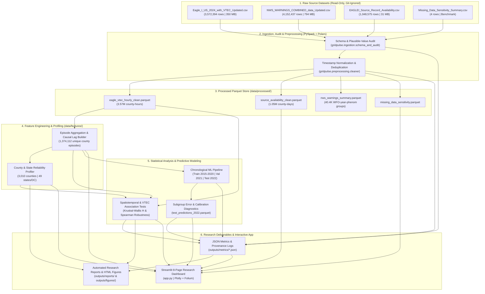

# GridPulse — System Architecture & Data Flow

## 1. Architectural Overview

GridPulse is designed as a modular, reproducible data engineering and research analytics system that runs reliably on a single student development machine while adhering to Big Data engineering best practices:

- **Ingestion & Schema Verification Layer (`gridpulse.ingestion`):** Uses **PySpark (`SparkSession`)** with explicit `StructType` schemas and **Polars** to validate column presence, timestamp formats, duplicate keys, and plausible physical bounds across all 4 raw CSV files (`1.23 GB` combined).
- **Preprocessing & Storage Layer (`gridpulse.preprocessing`):** Standardizes UTC timestamps, normalizes mixed date strings in the 4.15M-row NWS warning dataset, tracks exact row-count provenance at every filter step, and writes compressed **Zstandard Parquet** artifacts (`data/processed/`).
- **Feature Engineering Layer (`gridpulse.features`):** Resolves repeated hourly measurements into `1,374,112` distinct county-outage episodes `(fips_code, new_event_no)`, computes strictly causal `shift(1)` historical county lag features, and builds county (`3,010` counties) and state (`49` states/DC) reliability profiles (`data/features/`).
- **Analytical & Statistical Layer (`gridpulse.analysis`):** Computes diurnal/seasonal/annual aggregations, executes non-parametric Kruskal-Wallis hypothesis tests and Spearman completeness-sensitivity checks across NWS VTEC warning types, and assigns interpretable K-Means ($k=4$) county vulnerability archetypes.
- **Predictive Modeling & Evaluation Layer (`gridpulse.modeling`, `gridpulse.evaluation`):** Trains domain baselines (Onset Persistence & Empirical Bayes County-Weather Priors), L2-regularized Logistic Regression, and calibrated Histogram-Based Gradient Boosted Trees (`HistGradientBoostingClassifier`) on chronological splits (`2015–2020` Train, `2021` Validation, `2022` Untouched Test).
- **Interactive Presentation Layer (`app.py`, `gridpulse.dashboard`):** A fast **Streamlit + Plotly + Folium** web application that queries pre-computed Parquet and JSON artifacts using cached predicate pushdown without ever loading raw CSVs into memory.

---

## 2. End-to-End Data Flow Diagram



---

## 3. Repository Structure

```text
bda_project/
├── data/
│   ├── raw/                  # Optional directory for raw files (auto-resolves from project root)
│   ├── processed/            # Cleaned & aggregated Parquet tables (git-ignored)
│   └── features/             # Episode feature table & county/state reliability profiles (git-ignored)
├── src/
│   └── gridpulse/
│       ├── config.py         # Configurable paths, VTEC dictionary, state coordinates
│       ├── ingestion/        # PySpark StructType schemas, column validation, initial audit
│       ├── preprocessing/    # Timestamp parsing, deduplication, provenance tracking
│       ├── features/         # Episode aggregation, shift(1) causal lags, regional profiles
│       ├── analysis/         # Temporal trends, weather association tests, K-Means archetypes
│       ├── modeling/         # Chronological split, leakage guard, baselines, LR, HistGBM
│       ├── evaluation/       # ROC-AUC, PR-AUC, Brier score, calibration curves
│       ├── pipeline/         # End-to-end orchestrator & report/figure generator
│       ├── dashboard/        # Cached Streamlit Parquet & JSON loaders
│       └── utils/            # SparkSession lifecycle & atomic Zstandard Parquet writer
├── models/                   # Serialized trained model pipelines (.joblib, git-ignored)
├── outputs/
│   ├── metrics/              # Reproducible JSON audit, provenance, weather, and ML metrics
│   ├── reports/              # Automated markdown research findings report
│   └── figures/              # Standalone interactive Plotly HTML figures
├── tests/
│   └── test_gridpulse_pipeline.py  # 9 pytest unit tests using synthetic fixtures
├── scripts/
│   └── run_pipeline.py       # Staged CLI runner (--stage all|audit|preprocess|features|analyze|model|report)
├── docs/                     # Academic documentation & methodology reports
├── app.py                    # 8-page Streamlit interactive research application
├── requirements.txt          # Python package dependencies
├── README.md                 # Setup, execution, and troubleshooting guide
└── .gitignore                # Excludes raw CSVs, Parquet binaries, and model weights from Git
```
